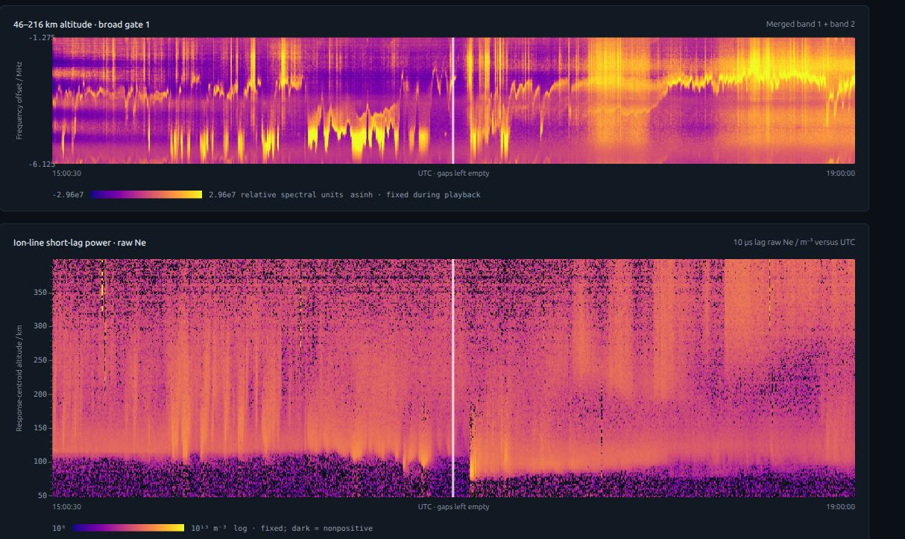
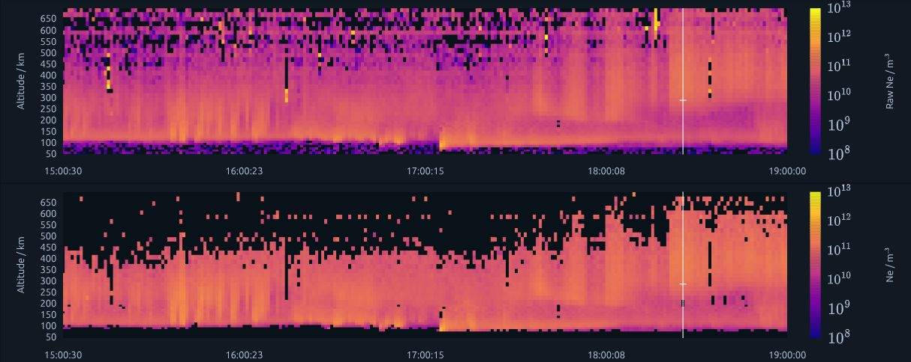
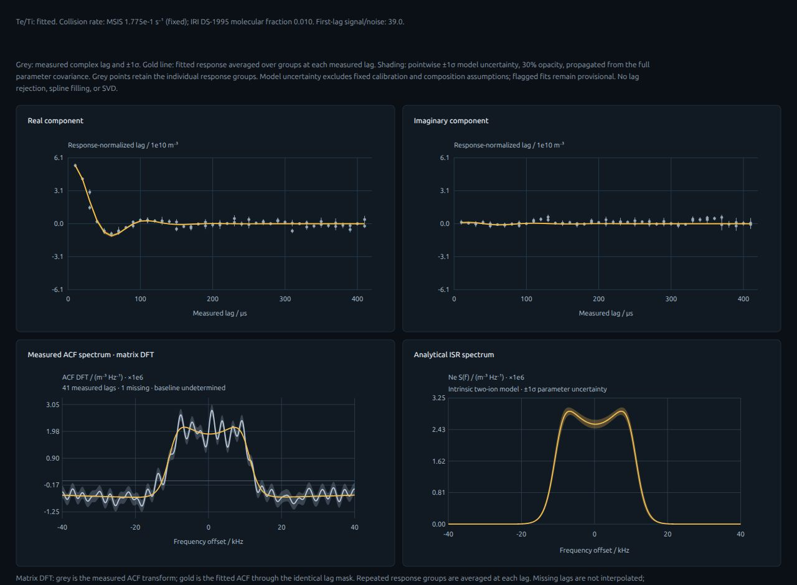

# RUISDAP

Rust implementation of EISCAT data analysis, with a browser user interface for
plasma-line spectra, ion-line fitting and calibration. It does not exactly
replicate GUISDAP.

The GUI uses Rust, WebAssembly and WebGL. The multicore Rust backend scales to
at least 128 cores and stores analysis products in HDF5. The GUI can run on a
separate static web server, using exported analysis products.

[Plasma-line browser](http://avaruus.uit.no/guisdap/) ·
[Ion-line browser](http://avaruus.uit.no/guisdap/ion.html)

## User interface

EISCAT UHF BEATA, 2 November 2022. Merged plasma-line receiver bands for the
46–216 km broad gate, with ion-line 10 µs short-lag power in raw electron-density
units below. The plasma-line display has the temporal median removed.

One-minute analysis: raw electron-density proxy from the 10 µs ion-line lag
(top) and fitted electron density (bottom), on shared time and altitude axes.
Rejected fits are set to NaN in the display; the raw measurements are retained.

High-SNR F-region ion-line ACF and spectra: 18:25–18:26 UTC, 277–297 km.
The first-lag signal-to-noise ratio is 39; the weighted residual score is 0.98.
This return persists across neighbouring minutes and altitude gates. Grey shows
measurements; gold shows the fitted response. The lower panels compare the
measured ACF matrix DFT with the analytical ISR spectrum.

## Documentation

- [Ion-line fitting](docs/ion-fitting.md)
- [MSIS collision rates and IRI ion composition](docs/prescribed-atmosphere.md)
- [Measured ACF spectrum](docs/measurement-spectrum.md)
- [Signal processing and range responses](docs/science.md)
- [Deployment](docs/deployment.md)
- [Legacy GUISDAP references](docs/legacy.md)
